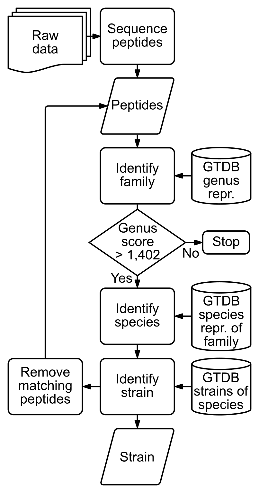

# NovoTax: prokaryotic strain identification from mass spectrometry-based proteomics data

Welcome! If you find any issues with this first release, please do not hesitate to open an issue or contact us directly (`dennis.svedberg at umu.se`)

## What is NovoTax?



**NovoTax** is a modular pipeline for identifying prokaryotic strains from mass spectrometry-based proteomics data.

The full NovoTax workflow is designed to go from mass spectrometry data to taxonomic assignment and a sample-specific protein database for downstream analysis.

## Why use it?

NovoTax is meant to be practical and accessible:

- one sample sheet
- one command to run
- containerized tools for reproducibility
- designed so non-experts can use it with minimal setup

## Pipeline setup

For more detailed instructions, please refer to the documentation:

- [`Intro`](docs/intro.md)
- [`Installation`](docs/installation.md)
- [`Usage`](docs/usage.md)
- [`Example`](docs/example.md)

## Quick start

### 1. What you need

You need:

- **Nextflow**
- **Apptainer** or **Docker**
- a **tab-separated sample sheet**

### 2. Sample sheet format

Create a tab-separated file like this:

| file_path                                | data_format |
|------------------------------------------|-------------|
| /full/path/to/folder/demo_xuanjinovo.mgf | dda         |
| /full/path/to/folder/demo_cascadia.mzML  | dia         |
| /full/path/to/folder/sample_peptides.tsv | peptides    |

Sample names and output folders are derived from each input filename by taking
everything before the first period (for example, `sample.run.mgf` becomes
`sample`). Derived names must be unique, start with a letter or number, and contain
only letters, numbers, periods, underscores, or hyphens.

With `data_format` set to `peptides`, the input bypasses de novo sequencing. The
file must contain exactly two tab-separated fields per nonblank row: peptide
sequence and probability score. A case-insensitive `peptide<TAB>score` header is
optional. Scores must be finite values from 0 to 1; rows at or above
`--denovo_score` are retained. Input order and repeated peptide observations are
preserved. Surrounding whitespace and bracketed annotations are removed from
peptide sequences, and isoleucine (`I`) residues are normalized to leucine (`L`)
for matching.

### 3. Run the pipeline

```bash
nextflow run main.nf \
  --input examples/samples.tsv \
  --output_dir example_results \
  --gtdb_protein_reps /data/dbs/gtdb/release226/protein_faa_reps \
  --gtdb_db_dir novotax_db_r226
```

## Output

NovoTax creates one folder per sample:
```
├── demo_xuanjinovo
│   ├── demo_xuanjinovo_genus_scores.png    - Graph showing genus scores across search iterations
│   ├── demo_xuanjinovo_peptides.txt        - Peptides entering the taxonomic search after score and optional cRAP/host filtering
│   ├── demo_xuanjinovo_strains.fasta       - FASTA containing the concatenated proteomes of all selected strains
│   ├── peptide_hits.tsv                    - Provenance and assignment status for peptides entering the taxonomic search
│   └── results.tsv                         - Run settings, timing, search results and summary counts
├── demo_cascadia
│   ├── demo_cascadia_genus_scores.png
│   ├── demo_cascadia_peptides.txt
│   ├── demo_cascadia_strains.fasta
│   ├── peptide_hits.tsv
│   └── results.tsv
```

`peptide_hits.tsv` contains one row for every peptide observation remaining after
the configured cRAP and host filtering. It records the source identifier, original
and searched sequence, input score, and whether the peptide was assigned to a
selected strain. For assigned rows, the MMseqs target and bit score describe the
best supporting hit within that strain; they are provenance fields rather than the
accession score used to select the strain. Repeated peptide observations remain
separate rows. An `unassigned` row was not assigned to a selected strain, but may
still have MMseqs matches. `results.tsv` records run settings, timestamps, top
search hits, iteration summaries, and the total taxonomic input, assigned, and
unassigned peptide-observation counts.


## Cite

If you use **NovoTax**, please cite the tools that make this possible:

**NovoTax**  
Svedberg D, Mateus A.  
*NovoTax: prokaryotic strain identification from mass spectrometry-based proteomics data.*  
bioRxiv. 2026.  
DOI: https://doi.org/10.64898/2026.04.02.715787

**Cascadia**  
Sanders J, Wen B, Rudnick PA, et al.  
*A transformer model for de novo sequencing of data-independent acquisition mass spectrometry data.*  
Nat Methods. 2025;22:1447–1453.  
DOI: https://doi.org/10.1038/s41592-025-02718-y

**XuanjiNovo**  
Jun A, Zhang X, et al.  
*MassNet: billion-scale AI-friendly mass spectral corpus enables robust de novo peptide sequencing.*  
bioRxiv. 2025.  
DOI: https://doi.org/10.1101/2025.06.20.660691

**MMseqs2**  
Steinegger M, Söding J.  
*MMseqs2 enables sensitive protein sequence searching for the analysis of massive data sets.*  
Nat Biotechnol. 2017;35:1026–1028.  
DOI: https://doi.org/10.1038/nbt.3988

**GTDB**  
Parks, D.H., et al.  
*GTDB release 10: a complete and systematic taxonomy for 715 230 bacterial and 17 245 archaeal genomes*  
Nucleic Acids Research, 2025.  
DOI: https://doi.org/10.1093/nar/gkaf1040
