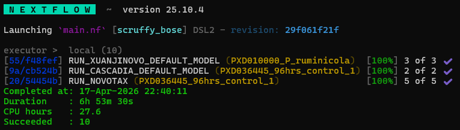
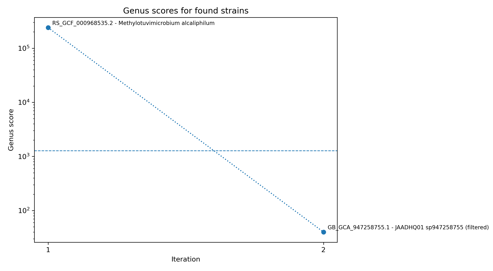
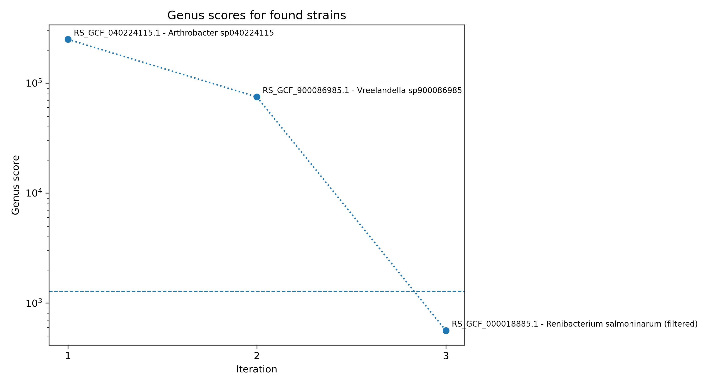
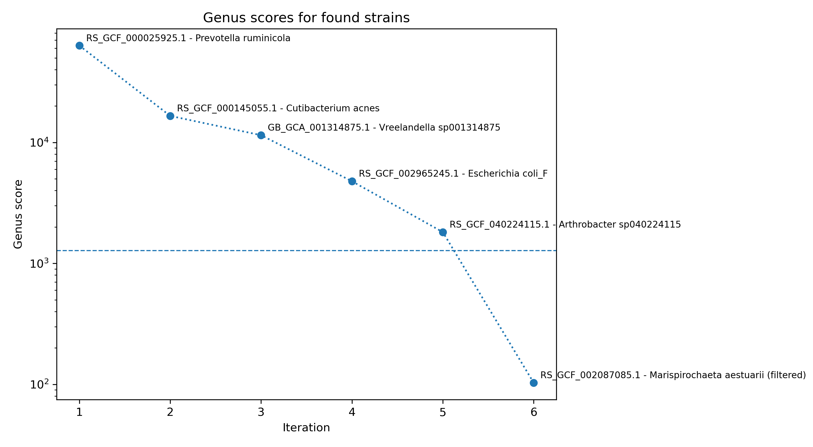
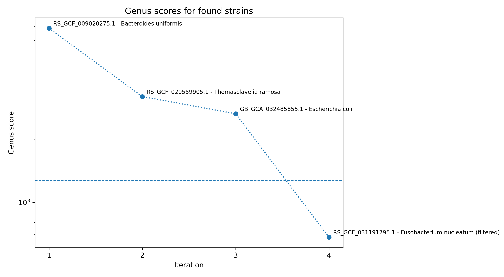

# Example run

## Data

The following example contains all the commands needed to run a subset of the analysis performed in the paper. The four files were chosen to represent both DDA and DIA data and several different findings:
* **PXD010000_M_alcali** `M_alcali_copp_MeOH_B2_T2_04_QE_23Mar18_Oak_18-01-07.mgf` - From [PXD010000](https://www.ebi.ac.uk/pride/archive/projects/PXD010000), DDA data with no detected contamination
* **PXD010000_HL93** `Biodiversity_HL93_HLHfructose_aerobic_3_09Jun16_Pippin_16-03-39.mgf` - From [PXD010000](https://www.ebi.ac.uk/pride/archive/projects/PXD010000), DDA data with two species detected (one probable contamination)
* **PXD010000_P_ruminicola** `Biodiversity_P_ruminicola_MDM_anaerobic_1_09Jun16_Pippin_16-03-39.mgf` - From [PXD010000](https://www.ebi.ac.uk/pride/archive/projects/PXD010000), DDA data with multiple species detected as probable contamination
* **PXD036445_96hrs_control_1** `20181112_QX8_PhGe_SA_EasyLC12-14_B_a8_221_TP96hrs_control_rep1.mzML` - From [PXD036445](https://www.ebi.ac.uk/pride/archive/projects/PXD036445), DIA data from a complex community

These files are [deposited to Zenodo](https://zenodo.org/records/19495971) and will be downloaded when running the example script.

## Running the example
First, please [verify that the environment is working correctly](installation.md#3-verify-the-environment-with-gpu-support) and [that the databases are set up](installation.md#4-setting-up-novotax). A guide to the expected output and interpretation is included below.

Start by downloading the data:
```bash
bash scripts/setup_example_data.sh
```

The example can then be run, [after making sure you set the appropriate flags and paths for your system](usage.md#flags), with:
```bash
nextflow run main.nf \
  -profile apptainer_wsl_gpu \
  --input examples/samples_extended.tsv \
  --output_dir extended_example_results/ \
  --gtdb_protein_reps /data/dbs/gtdb/release226/protein_faa_reps \
  --gtdb_db_dir novotax_db_r226
```

## Expected output

A successful run will look something like this:  


NovoTax derives each sample directory from the corresponding input filename. The results folder structure is:
```
├── extended_example_results
│   ├── M_alcali_copp_MeOH_B2_T2_04_QE_23Mar18_Oak_18-01-07
│   ├── Biodiversity_HL93_HLHfructose_aerobic_3_09Jun16_Pippin_16-03-39
│   ├── Biodiversity_P_ruminicola_MDM_anaerobic_1_09Jun16_Pippin_16-03-39
│   └── 20181112_QX8_PhGe_SA_EasyLC12-14_B_a8_221_TP96hrs_control_rep1
```

Each sample folder contains `<sample_name>_genus_scores.png`, `<sample_name>_peptides.txt`, `<sample_name>_strains.fasta`, `peptide_hits.tsv`, and `results.tsv`. The peptide list contains the above-threshold observations remaining after the configured cRAP and host filtering. `peptide_hits.tsv` records provenance and final assignment status for those observations.

Below, you can find the results of each sample.

### PXD010000_M_alcali
`M_alcali_copp_MeOH_B2_T2_04_QE_23Mar18_Oak_18-01-07.mgf`

In this example, only one strain is clearly identified above the genus threshold score: *M. alcaliphilum* (the species reported to be present in the sample).




### PXD010000_HL93
`Biodiversity_HL93_HLHfructose_aerobic_3_09Jun16_Pippin_16-03-39.mgf`

In this example, two strains are clearly identified above the genus threshold score: *Arthrobacter sp.* and *Vreelandella sp.* The species reported by the authors *Halomonas sp. HL93* has been named *Vreelandella sp900086985* in GTDB, thus this example shows that two species are likely present in the sample. In the [NovoTax manuscript](https://www.biorxiv.org/content/10.64898/2026.04.02.715787v1), we show strong evidence that the second species is indeed present in the sample.



### PXD010000_P_ruminicola
`Biodiversity_P_ruminicola_MDM_anaerobic_1_09Jun16_Pippin_16-03-39.mgf`

In this example, five strains are identified above the genus threshold score: *Prevotella ruminicola* (the strain reported by the authors), *Cutibacterium acnes*, *Vreelandella sp.*, *Escherichia coli*, and *Arthrobacter sp.*. In the [NovoTax manuscript](https://www.biorxiv.org/content/10.64898/2026.04.02.715787v1), we show strong evidence that *C. acnes* is also present in the sample. Peptides from the other strains are also likely present, but we suspect that they originate from cross-contamination with other samples (e.g., carryover in the LC-MS analysis, given that all of them are species that the authors also analyze in their [dataset](https://www.ebi.ac.uk/pride/archive/projects/PXD010000)). Regardless, best practice in proteomics says that one should search the raw data with all species that are likely present to correctly control the false discovery rate. Thus, we suggest that the output fasta with all 5 strains is used for a traditional proteomics search.



### PXD036445_96hrs_control_1
`20181112_QX8_PhGe_SA_EasyLC12-14_B_a8_221_TP96hrs_control_rep1.mzML`

In this example, we demonstrate that NovoTax can also work with DIA data from species communities. We use a single file for illustration purposes, but, in communities, analyzing more files from different conditions is likely to identify more strains. The species identified here are all known to be part of the original community, including the one below the genus threshold. Thus, if the user wants the software to keep running, it is possible to lower the threshold using the `--genus_score` flag. Note: care should be taken when lowering this threshold, as false positives might start appearing. We have calibrated the genus score based on single species samples, and the threshold is already quite relaxed (corresponding to the median genus score of the peptides left after the first round of NovoTax on single species samples).


